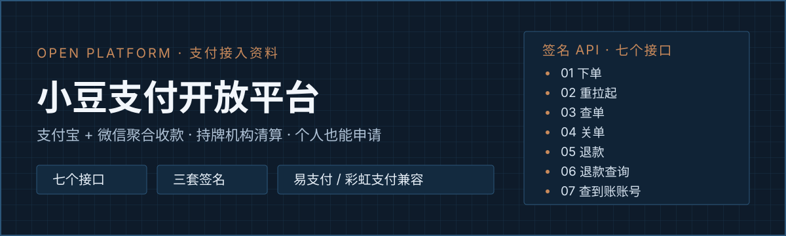
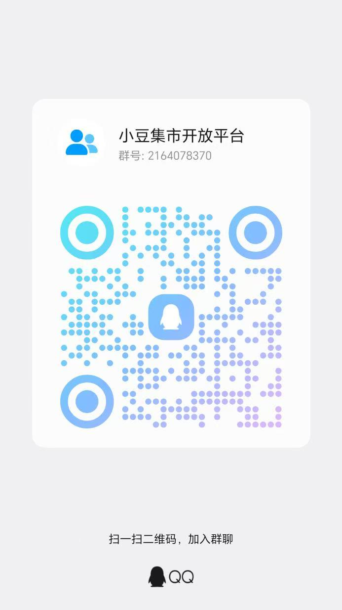

# 小豆支付开放平台 · 个人支付接口与虚拟发卡 / 数字商品接入资料（支付宝 + 微信聚合收款 · 持牌机构清算）

<p align="center">
  
</p>

**直接找**：[接口一览](#接口一览) ｜ [五分钟上手](#五分钟上手) ｜ [易支付协议兼容接入](./docs/13-epay-compat-integration.md) ｜ [到账账号与收款分配](./docs/14-settlement-accounts.md) ｜ [文档目录](#文档目录14-篇) ｜ [常见问题](#常见问题faq)

> 线上入口（买家浏览与**卖家中心 / 免费开店**都在这里）：<https://xdjishi.cn/>

> **可点击演示**（不用注册、零联网，数据全为演示值；在浏览器里点着走完「申请 → 收款 → 到账」）：<https://xdfair.cn/demo/>

> **在线文档中心**（14 篇文档逐篇成页，可下载文档包与 Skill 包）：<https://xdfair.cn/docs/> ｜ [Skill 页](https://xdfair.cn/skill/) ｜ [文档与 Skill 下载](https://xdfair.cn/downloads/)

> **中文产品页**：个人接入说明 <https://xdfair.cn/individual/> ｜ 易支付签名校验工具 <https://xdfair.cn/tools/epay-sign/>（浏览器本地计算，不登录、不传密钥）

**你已经有一套卖虚拟商品的系统，只缺「收钱」这一环？** 卡密、激活码、课程、专栏、电子书、软件、素材模板、会员权益、游戏道具——**凡是线上交付的数字商品**都能用它收款；**当面交易的实物**也可以。

**没有营业执照也没关系——个人就能申请。** 主体类型选「个人」：一张身份证 + 一张本人银行卡，跟着向导走完入驻，手续极简；个体工商户与企业同样支持。**个人网站、个人开发者、个人用户都是同一套接口**：网站只需要在服务器端调用接口，页面、商品和发货留在你自己的系统里。

这套接口就是干这个的：帮你把**支付宝和微信**收进来，告诉你「钱到没到」，再把钱结给你。下单、查单、关单、退款，外加一个只读的「查到账账号与收款分配」——一共七个接口。

钱由**有支付牌照的支付公司**收和结，**不经过我们的账户**——我们只负责把状态讲清楚，货还是你的系统自己发。

**系统里已经装着「易支付 / 彩虹支付」类插件？** 不用改代码：把**网关地址 / 商家 ID / 商户密钥**三个值填进插件，就能用同一条收款链——我们提供**易支付 / 彩虹支付协议兼容**接入面，**兼容该协议的多种接口**（`submit.php` 表单收单 / `mapi.php` 程序化收单 / `api.php` 查询），见[易支付协议兼容接入](./docs/13-epay-compat-integration.md)。

费用**全平台统一一档**：平台服务费 1.5%（商家实收 98.5%），手续费 0.01 元起；每一单的准确金额仍以响应里的 `feeProjection` 为准。 服务费**默认从商家结算款内扣（卖家承担）**；买家承担为灰度能力（2026-10-20 起已开通，仍受单笔上限与平台闸门约束），以订单接口返回为准。**入驻、开通、接入对接全程免费**：没有搭建费、入驻费、开通费，也不另收通道费，没有任何一次性收费。

这个仓库就是它的**全部接入资料**：14 篇文档、四种语言的签名示例、一个能跑起来的本地演示，还有一份可以直接丢给 AI 编码助手（Claude Code、Codex 之类）的 Skill。**跟你在商家后台看到的是同一份内容。**

> 版本看 [`MANIFEST.json`](./MANIFEST.json)（`skillVersion`、API 版本、签名版本、`contentHash` 都在里面）。
> 这里是**接入资料，不是官方 SDK**——我们不发包，示例代码是给你直接抄的参考实现。
> 这里是这份资料的**唯一出处**：商家后台里的那版和公开发布的这版，都由这里产出。

**这个仓里有什么（不用先申请账号，直接拿）**：

- **14 篇接入文档** —— 从「5 分钟跑通首单」到终端行为、错误码、上线检查、密钥轮换；
- **四种语言的签名示例**（Node.js / Java / PHP / Python），带一份**可以自己跑的对照值**；
- **本地演示**（`demo/h5-cashier/`）—— 零依赖，断网也能跑通「下单 → 收款 → 查单 → 关单 → 退款 → 收通知」整条链；
- **一份 AI Agent Skill**（[`skill/`](./skill/SKILL.md)）—— 丢给编码助手就能照着接，和后台下载的那份一模一样。

## 先说清楚：这是干什么的、不干什么

一句话：**你负责卖货和发货，我们负责收钱、把状态讲清楚、按设置把钱结给你。**

我们做的是**支付**这件事，不是帮你开网店：

| 我们做 | 你做 |
| --- | --- |
| 下单、收钱、支付状态和终态通知 | 商品、库存、定价、页面 |
| 查单、关单、退款、退款查询 | **发货本身**：发卡密、开通服务、寄快递、开票、售后 |
| 每一单的费用明细（`feeProjection`）与结算 | 你自己的订单库、对账、客服 |
| 域名归属验证（可选自助）、IP 白名单、三套签名（请求 / 响应 / 通知） | 保管和轮换你自己的密钥 |

**发货是你自己的事**：收银页上不放货，`returnUrl`（付完跳回来那个地址）**也不代表付款成功**——到底成没成，只认「查单」或者验过签的「事件通知」。这两件事搞错的团队最多，详见[接入指南](./docs/02-integration-guide.md)。

## 适合谁、不适合谁

| | |
| --- | --- |
| ✅ 适合 | 你已经有自己的发货 / 开通系统，想要一条**H5、JSAPI**收款通道：建单、拿收款码、收终态通知、退款、对账。 |
| ✅ 适合 | **个人 / 没有营业执照的个人开发者**：主体类型选「个人」，身份证 + 本人银行卡即可完成入驻，接口与其他主体完全一致。 |
| ✅ 适合 | 你卖的是**虚拟卡密类数字商品**，或者**当面交易的实物**。 |
| ✅ 适合 | 你的买家要用**支付宝**或**微信**付款。 |
| ❌ 不适合 | 你想要「上传卡密就能开卖」的一站式发卡系统 —— 那用**小豆集市**的卖家后台（见下一节），不用写代码。 |

## 两条路，选一条

| 你的情况 | 走哪条 |
| --- | --- |
| 已经有自己的发卡 / 发货系统，只缺**收钱和结钱** | **本开放平台**：接这七个接口，发货还是你自己发 |
| 还没有系统，就想**上架卡密直接开卖** | **小豆集市**（卖家后台）：上架商品、导卡密，买家付完钱自动发卡，订单售后结算都在后台 |
| 两个都想要 | 可以。同一个人既是小豆集市的卖家、又是开放平台的商家，钱路是同一条 |

> **想直接开店卖货（不用写代码）**：小豆集市的产品说明也在公开仓，**同样不用注册就能看** ——
> [GitHub](https://github.com/xiaodou-official/xiaodou-market) ｜ [Gitee 镜像](https://gitee.com/lu-wulei/xiaodou-market)

> **卖家在手机上管店**：用微信小程序「小豆集市」——卖家的手机经营台（看商品 / 订单 / 结算；
> 上货、进件与售后办理仍在网页端）。买家侧在 <https://xdjishi.cn/>，全程免注册。

## 个人网站如何接入支付宝 / 微信支付？

个人网站不需要企业资质，也不需要改成商城：网站只在**服务器端**调用接口，页面、商品、发货和售后都留在你自己的网站。个人开发者、个人用户与个人网站走的是同一条链，接口与个体工商户 / 企业完全一致。

1. **完成商户进件**：主体类型选「个人」，身份证 + 本人银行卡，按五步向导提交审核（见[怎么开通](#常见问题faq)）。
2. **申请开放平台应用**：拿到 `appId` / `kid`，登记 RSA2 公钥、服务器出口 IP 白名单和 `notifyUrl`。
3. **服务器端下单**：调用下单接口，拿 `payUrl`（收银页）或支付宝官方收款码 `qrCode`；把收款码画在你自己的网页上，或把 `payUrl` 生成二维码 / `302` 跳转。
4. **接收并验签通知**：按 `XD-Webhook-v1` 用原始字节验签，按 `eventId` 去重，更新你自己的订单库。
5. **上线自检**：付款是否成功只认查单结果或验过签的通知；按[上线检查清单](./docs/11-go-live-checklist.md)逐条核对，再跑一笔小额真实订单。

第一次接入建议从[五分钟上手](./docs/01-quickstart.md)开始；接口参数见[API 参考](./docs/03-api-reference.md)。

## 接口一览

**七个接口**（路径拼在平台给你的 `<BASE_URL>` 后面，主版本 `v1`，版本内只加不改）：

| 接口 | 干什么 |
| --- | --- |
| `POST /api/open/v1/payments` | 建订单（同一个单号重复提交不会建两笔） |
| `POST /api/open/v1/payments/{outTradeNo}/attempts` | 重新拉一次支付（换一份新的收款材料） |
| `GET /api/open/v1/payments/{outTradeNo}` | 查订单（以我们这边为准） |
| `POST /api/open/v1/payments/{outTradeNo}/close` | 关订单（会先跟支付公司确认没付过款） |
| `POST /api/open/v1/refunds` | 发起退款 |
| `GET /api/open/v1/refunds/{outRefundNo}` | 查退款 |
| `GET /api/open/v1/settlement/accounts` | 查到账账号与收款分配（只读：有哪些到账账号、当前按什么规则分；收款方式的设置在商家后台） |

除上面七个签名接口外，另有一条**易支付 / 彩虹支付协议兼容**接入面（资金链同一条）：在给到你的网关地址下，按该协议惯例提供 `submit.php`（表单收单）、`mapi.php`（程序化收单）与 `api.php`（订单 / 商户查询）**多种协议接口**——系统里已装易支付 / 彩虹支付类插件的商家**不用改代码**就能切过来，见[易支付协议兼容接入](./docs/13-epay-compat-integration.md)。

**收款材料有两种标准用法**：在**你自己的电脑网页**上把官方收款码（`qrCode`，只有支付宝渠道会给）画成二维码；或者把我们的收银页地址（`payUrl`）画成二维码、或者直接 `302` 跳过去。细节见[收银页对接](./docs/06-cashier-integration.md)。

**三套签名，别用同一段代码**：你发给我们的请求要签（`XD-Signature-v1`）、我们的响应要签（`XD-Response-v1`）、通知事件也要签（`XD-Webhook-v1`）。**三套拼串规则不一样**，抄同一段一定会挂；我们的公钥和指纹在[接入指南 §3.1](./docs/02-integration-guide.md#31-平台公钥与指纹公示)里公开。

**四条铁律，记住能少踩九成的坑**：

1. **收银页打开了、买家付完跳回来了、点了「我已完成支付」——都不算付款成功**。只有查单、或者验过签的通知才算数。
2. **重试要用同一个 `requestId`、同一份请求内容**。收到 `409` 该做的事是**去查单**，不是换个单号重新下单。
3. **看到 `UNKNOWN` 别急着判死**：不要重新下单、不要重发退款、不要跟买家说「失败」，等通知或者查单收敛。
4. **私钥永远不进浏览器、不进仓库、不进日志**。费率和限额**不要写死在代码里**——每一单响应里的 `feeProjection` 才是那一单的真实口径。

## 常见叫法与本资料的对应（你可能这样搜）

| 你可能用的叫法 | 在本资料里对应什么 |
| --- | --- |
| 支付平台 / 聚合支付 / **聚合收款** / 聚合码支付 | 一套接口同时接**支付宝和微信**两条通道（`ALIPAY_H5` / `WECHAT_H5`），通道在**下单那一刻定死**；我们聚合的是**接入、状态和对账**，钱的收付结算是持牌支付公司做的 |
| **支付接口** / 支付 API / 云支付 | 就这七个：建单、重拉、查单、关单、退款、查退款、查到账账号与收款分配（见[接口一览](#接口一览)） |
| **个人支付** / **个人收款** / **个人接入收款** / 个人开发者收款 | **个人可以申请**：主体类型选「个人」，身份证 + 本人银行卡即可入驻，接口与个体工商户 / 企业完全一致（见[怎么开通](#常见问题faq)） |
| **个人网站接入** / **个人网站收款** / 个人用户接入支付宝微信 | 网站只在**服务器端**调用七个接口；页面、商品、发货都留在你自己的网站。个人主体进件后接口与其他主体一致（见下方「个人网站如何接入支付宝 / 微信支付」） |
| **个人接入支付 API** / **支付接口 API** | 就是[接口一览](#接口一览)里的七个接口：下单、重拉、查单、关单、退款、查退款、查到账账号；请求签名 `XD-Signature-v1`，四语言示例在 `examples/` |
| **收款通道** / 收款接口 / 支付通道 | 就是本仓这七个接口：一条**服务器对服务器**的收款通道，钱由持牌支付公司收付结算（见[接口一览](#接口一览)） |
| **免费接入** / 免搭建费 / 不收入驻费 | **入驻、开通、接入对接全程免费**——没有搭建费、入驻费、开通费，也不另收通道费（见[资金与结算](#资金与结算)） |
| **H5 支付** / H5 远程支付 | 我们的收银页（`payUrl`）：电脑扫码、手机浏览器、微信里打开，三种情况行为不一样（见[终端能力矩阵](./docs/06-cashier-integration.md)） |
| **收款码** | 下单响应里的**官方收款码** `qrCode`（只有支付宝渠道给，而且只有**下单那一次响应**里有），可以直接画在你自己的电脑网页上 |
| **微信收款 / 支付宝收款** | 两条通道的能力面都做好了；**支付宝现在就能接**，**微信 JSAPI 已开放**——买家在微信内打开收银页即可调起微信支付（仅限微信内浏览器；微信外手机浏览器与商家 App 内没有「直接拉起」形态；桌面微信内置浏览器同样按微信内链路处理，若无法完成支付请改用手机微信打开同一链接）。其他通道或交易形态的放行仍以对接人确认为准（放行由平台整体控制、不区分应用，后台没有查询面；未放行时下单返回一个可预期的拒绝，见 [FAQ](#常见问题faq)） |
| **虚拟发卡** / 卡密 / 自动发货 / 发卡系统 | 我们只管收钱和支付状态，**发货是你自己的系统发**；不想写代码就去[小豆集市的卖家后台](#两条路选一条) |
| **次日中午前到账 / 无需手动提现** / 自动结算到银行卡 | 付成功就当场分账，然后按设置**自动转到你绑定的银行卡**——现在是**次日中午前到账（含节假日）**，**不用你手动提现**（见[资金与结算](#资金与结算)） |
| **持牌机构** / 资金安全 / 资金托管 / 担保交易 | **央行持牌机构清算，安全可靠的个人和企业支付接口**。收付结算都是**有支付牌照的支付公司**做的，所以这里没有需要我们来「担保」的沉淀资金（跟[免签那类做法](#常见问题faq)的区别就在这） |
| 独立站收款 / 私域收款 / 知识付费收款 | 你只需要在服务器上接下单和通知，**页面、商品、发货都留在你自己的系统里** |
| 易支付 / 彩虹支付 / 码支付 这类「**免签**」系统 | **不是一回事**，钱走的路完全不一样——见 [FAQ](#常见问题faq) 里的对比。**但如果你系统里装的正是「易支付 / 彩虹支付」插件**（只会填网关 / 商家 ID / 密钥三格的那种），我们另有一条**易支付 / 彩虹支付协议兼容**接入面：不用改代码（`submit.php` / `mapi.php` / `api.php` 多种协议接口）、资金仍走持牌支付公司，见[易支付协议兼容接入](./docs/13-epay-compat-integration.md) |

> 这些都是行业里的习惯叫法，方便你对上号；**具体字段和取值以文档里写的为准**。

**English keywords（方便英文检索对上号 / so English searches can find us）**：

`payment gateway API` · `aggregate payment` · `Alipay + WeChat Pay integration` · `virtual goods payment` · `card key / digital code selling` · `faka platform payment` · `merchant payment API docs` · `epay / caihong epay protocol compatible gateway (submit.php / mapi.php / api.php)` · `RSA2 request signature` · `webhook signature verification` · `payment integration examples` · `Node.js / Java / PHP / Python signature sample` · `licensed payment institution settlement` · `openapi payment China` · `personal website payment integration` · `individual developer payment API` · `accept payments as an individual` · `payment API without business license`

## 资金与结算

- **央行持牌机构清算，安全可靠的个人和企业支付接口**：付成功就按**下单时定好的分配**当场分账，我们提供的是接入、状态和对账能力。
- **钱先进哪个账户、按什么规则分，由你的「收款分配」说了算**：可以绑定多个到账账号，单账号全额、按顺序轮流或比例分账（2–4 个参与账号，配置面每项 `0 < shareBps < 10000`、合计 10000bps）；**一单一结、随单冻结**，退款按原订单冻结的分配快照发起回退（实际到账路径以支付服务方原交易与分账合同为准）。查当前分配用 `GET /api/open/v1/settlement/accounts`，详见[到账账号与收款分配](./docs/14-settlement-accounts.md)。
- **收付和结算都是有支付牌照的支付公司做的**，按设置**自动转到你绑定的银行卡** —— **不用你手动提现**。现在是**次日中午前到账**（含节假日）。
- **费率公开、全平台统一一档**：平台服务费 1.5%（商家实收 98.5%），手续费 0.01 元起。每一单响应里的 `feeProjection`（带 `ruleVersion`）就是那一单的准确口径，入账用它；如果你有单独约定过的费率，以商家后台「费率说明」页按账户实时展示为准。**限额按主体类型判定**：对公（个体工商户/企业）主体不设平台业务金额上限，实际以支付服务方额度为准；个人主体按平台默认档。具体数字不在文档里写死（没有自助查询面，越界被拒时走官网反馈渠道）。
- **没有任何一次性收费**：入驻、开通、接入对接**全程免费**——不收搭建费、入驻费、开通费，也不另收通道费；我们会收的费用只有上一条那档按笔计的口径，没有隐藏项目。
- 结算周期、到账时间**都会变**：**一律看后台当时显示的**；微信 JSAPI 已开放（仅微信内打开收银页），其他通道或交易形态是否放行以对接人确认为准（后台无查询面）。别抄进你的对外文案或代码常量里。

## 五分钟上手

1. 读[快速开始](./docs/01-quickstart.md)：拿到 `appId`、`kid` 和私钥后，把第一笔请求跑通。
2. 用 [`examples/node/`](./examples/node/)（或 Java / PHP / Python）生成六个请求头，先拿 [golden 向量](./examples/README.md)对一遍，确认拼串没错。
3. 读[收银页对接与终端能力矩阵](./docs/06-cashier-integration.md)，决定你的收款页长什么样。
4. 接[事件通知验签](./docs/05-webhook-verification.md)，按 `eventId` 去重。
5. 上线前逐条过一遍[上线检查清单](./docs/11-go-live-checklist.md)。

**不想先申请账号？** 本地演示用回环地址 + 假数据把整条链跑通，不连线上、不需要任何凭证：

```bash
node demo/h5-cashier/server.js        # 商家控制台 + 终端预览 + 收银页示意
node demo/h5-cashier/smoke.js         # 冒烟自检（含负向用例），打印 [OK]
```

## 文档目录（14 篇）

| # | docId | 篇目 | 文件 |
| --- | --- | --- | --- |
| 1 | `XD-OP-01` | 快速开始（5 分钟跑通首单） | [`docs/01-quickstart.md`](./docs/01-quickstart.md) |
| 2 | `XD-OP-02` | 接入指南 | [`docs/02-integration-guide.md`](./docs/02-integration-guide.md) |
| 3 | `XD-OP-03` | API 参考 | [`docs/03-api-reference.md`](./docs/03-api-reference.md) |
| 4 | `XD-OP-04` | 错误码与排障 | [`docs/04-errors-and-troubleshooting.md`](./docs/04-errors-and-troubleshooting.md) |
| 5 | `XD-OP-05` | webhook 验签 | [`docs/05-webhook-verification.md`](./docs/05-webhook-verification.md) |
| 6 | `XD-OP-06` | 收银页对接与终端能力矩阵 | [`docs/06-cashier-integration.md`](./docs/06-cashier-integration.md) |
| 7 | `XD-OP-07` | 费率与限额 | [`docs/07-fees-and-limits.md`](./docs/07-fees-and-limits.md) |
| 8 | `XD-OP-08` | 退款与对账 | [`docs/08-refund-and-reconciliation.md`](./docs/08-refund-and-reconciliation.md) |
| 9 | `XD-OP-09` | 安全红线 | [`docs/09-security-redlines.md`](./docs/09-security-redlines.md) |
| 10 | `XD-OP-10` | 更新日志与变更公告 | [`docs/10-changelog.md`](./docs/10-changelog.md) |
| 11 | `XD-OP-11` | 上线检查清单（Go-Live Checklist） | [`docs/11-go-live-checklist.md`](./docs/11-go-live-checklist.md) |
| 12 | `XD-OP-12` | 凭证与密钥管理 | [`docs/12-credential-key-management.md`](./docs/12-credential-key-management.md) |
| 13 | `XD-OP-13` | 易支付协议兼容接入（已有插件的系统怎么切过来） | [`docs/13-epay-compat-integration.md`](./docs/13-epay-compat-integration.md) |
| 14 | `XD-OP-14` | 到账账号与收款分配（查询接口） | [`docs/14-settlement-accounts.md`](./docs/14-settlement-accounts.md) |

## 常见问题（FAQ）

**这是「虚拟发卡平台」吗？**
我们只做**收钱和支付状态**，发货（发卡密 / 开通 / 寄出）是你自己的系统做的。如果你要的是「上架卡密就能卖」，那用**小豆集市**的卖家后台，不用写代码；两边的钱路是同一条。

**微信和支付宝都能收吗？**
两条通道都做好了（支付宝：官方收款码 + 收银页；微信：在微信里打开页面后调起支付）。**支付宝现在就能接；微信 JSAPI 已开放**——买家在微信内打开收银页即可调起微信支付（仅限微信内浏览器；微信外手机浏览器与商家 App 内没有「直接拉起」形态）。其他通道或交易形态的放行仍由平台整体控制（不区分应用、后台没有查询面，也不要靠试探下单确认）。未放行时下单会返回 `422` `OPEN_API_CHANNEL_UNAVAILABLE`，这是**正常的、可预期的拒绝**，别当故障、更别反复重试。

**钱多久到账？要手动提现吗？**
付成功就当场分账，然后按设置**自动转到你绑定的银行卡**——**不用手动提现**。现在是**次日中午前到账**（含节假日）；周期和时效会随渠道和设置变，以后台「资金 / 结算」页显示的为准。

**你们会经手或者压着我的钱吗？**
不会。**央行持牌机构清算，安全可靠的个人和企业支付接口**：收付和结算都是有支付牌照的支付公司做的，付成功就按定好的分配当场分到各方。

**你们是「易支付 / 码支付」那类系统吗？**
不是，钱走的路完全不一样。那类叫法一般指**免签 / 第四方代收**：先用个人收款码或别人的账户把钱收进来，再转给卖家，**钱会经过中间方的账户**。我们是另一条路：**商家在有支付牌照的支付公司开自己的结算账户**，买家付完钱，钱在公司那边**当场分到各方账户**，再按设置转到你绑定的银行卡 —— **央行持牌机构清算，安全可靠的个人和企业支付接口**。你要是想要前一种，我们做不了；你要是想要「自己有正规结算账户 + 一套接口接完支付宝和微信 + 次日中午前到账（含节假日）」，接着往下看。

**我系统里已经有「易支付 / 彩虹支付」插件，怎么切过来？**
如果你系统里的支付插件只让你填三格——**网关地址、商家 ID、密钥**（有的系统把网关叫「接口地址」或「支付网关」，是同一个值）——那它用的就是这一类老式共享密钥协议，我们的「易支付接口配置」按同一套协议收单：在卖家后台上开通、把页面给的三个值填进那三格就能用，**不用改你系统的代码**。注意网关**不是**「应用凭证」页的接入地址（Base URL，通常 `api.` 开头）。协议细节、参数与签名规则、支持范围见[易支付协议兼容接入](./docs/13-epay-compat-integration.md)。**资金路径和免签那类做法完全不同**（见上一条），这条接入面只是把**协议**对上，钱一样走持牌支付公司、进你自己的结算账户。

**手续费多少？**
**平台服务费 1.5%（商家实收 98.5%），全平台统一一档，手续费 0.01 元起。**每一单响应里的 `feeProjection` 就是那一单的准确口径（带 `ruleVersion`，拿它对账）；如果你有单独约定过的费率，以商家后台「费率说明」页按账户实时展示为准。限额按主体类型判定（对公主体不设平台业务金额上限，实际以支付服务方额度为准；个人主体按平台默认档），也没有自助查询面（越界被拒时走官网反馈渠道，附 `requestId`）。详见[费率与限额](./docs/07-fees-and-limits.md)。

**要交搭建费 / 入驻费 / 通道费吗？**
都不用。**入驻、开通、接入对接全程免费**：不收搭建费、不收入驻费、不收开通费，也不另收通道费。我们会收的费用只有上面写明的那一档（按笔计），没有一次性收费、没有隐藏项目。市面上有些平台会先收一笔搭建费或通道费、再叠加抽成；在我们这里，这份资料里写的费用就是全部。

**有沙箱或测试环境吗？**
暂时没有沙箱、测试应用和回调模拟器。替代办法：本地演示（零依赖，全链路假数据）+ [上线检查清单](./docs/11-go-live-checklist.md) + 第一笔线上小额单我们陪你盯（**不承诺 SLA**）。**本地跑通只能证明签名和解析没错，证明不了资金链通。**

**要自己写代码吗？用什么语言？**
接入是**服务器对服务器**的：下单 / 查单 / 退款 + 通知验签。仓库给了 Node.js、Java、PHP、Python 四份签名示例，**拼出来的串完全一样**，还带对照值；通知验签另有 Node 的参考实现。

**收银页能自己设计吗？**
两种标准做法：在**你自己的页面**画官方收款码，或者把 `payUrl` 画成二维码 / 直接 `302` 跳过去。**别照抄我们收银页的样子**——真正的收银页在我们这边、而且是品牌中立的；也别在你自己的 App 里用内置浏览器打开，必须跳到系统浏览器。

**怎么开通？个人可以申请吗？**
**可以，个人就能申请——没有营业执照也行。** 从页首那个入口进「卖家中心 / 免费开店」→ 注册小豆账号 → 完成**商户进件**（主体类型选「个人」：上传身份证正反面、填一张本人银行卡，五步向导、手续极简；个体工商户与企业同理，另加营业执照）→ 签开放平台服务协议和经营范围合规报送同意书 → **一键申请应用**（提交后自动审）→ 拿到 `appId`、`kid`，登记你的 RSA2 公钥、配好出口 IP 白名单和 `notifyUrl`。申报域名由你自己填写，**平台不强制核验归属**——顺手做一次**域名归属验证**（DNS TXT 或者放一个回源文件，二选一）会更稳妥：域名被他人冒用申报时，验证过的归属更明确。

**个人网站 / 个人开发者 / 个人用户怎么接入收款？**
用同一个个人主体：身份证 + 本人银行卡完成进件，拿到 `appId` / `kid` 后，在**服务器端**调用下单、查单、退款和通知验签接口即可；网站前端只负责展示收款码或跳转收银页，**私钥不要放进浏览器**。接口与个体户 / 企业一致，不需要营业执照。具体步骤见上文「个人网站如何接入支付宝 / 微信支付」。

**密钥怎么轮换？**
我们用同一把 RSA2 密钥给响应和事件签名，公钥和指纹在文档页和后台**两处都公开**（你可以自己算一遍指纹核对）。你自己的签名密钥可以自己换；我们这边换钥会同时发布新的 `kid` 和新公钥，新旧并存期间按 `kid` 选公钥。**紧急吊销不受宽限影响**，宽限窗最长 72 小时。详见[凭证与密钥管理](./docs/12-credential-key-management.md)。

## English

Xiaodou Open Platform (小豆支付开放平台) is a server-to-server payment API for merchants that already run their own system in mainland China. It accepts Alipay and WeChat Pay, returns signed webhook events for payment status, and settles funds through a licensed payment company into the merchant's own account.

- Eligibility: mainland China only. Individuals can apply with a Chinese resident ID card and a bank card issued in mainland China; no business license is required. Onboarding is manually reviewed and is not instant. Overseas entities cannot open an account directly.
- Payment methods: Alipay and WeChat Pay. Inside Alipay you may choose Huabei or a credit card; inside WeChat Pay you may use a credit card, subject to what the cashier displays. These are payment tools inside the cashier, not separate channels.
- Fees: A 1.5% platform fee applies only to successful online payments; merchants keep 98.5%; fees start at CNY 0.01. Onboarding, activation and integration support are free.
- Payout: funds are split when the payment succeeds and automatically settled to the bank card bound to your account before noon the next day, including holidays. There is no manual withdrawal button.
- Boundaries: the platform only collects money and reports payment status; delivery, provisioning and shipping remain in your own system. No sandbox, test application or callback simulator is provided. WeChat JSAPI works only inside the WeChat browser.
- English pages: <https://xdfair.cn/en/> · <https://xdfair.cn/en/individual/> · <https://xdfair.cn/en/compatibility/epay/>

Use with Claude Code / Codex / Cursor / Copilot: point the assistant at [`skill/SKILL.md`](./skill/SKILL.md) and [`examples/`](./examples/); the skill is content, not an SDK.

## 目录结构

```
README.md          本文件（简介 / 索引 / 版本 / 许可证 / 免责）
MANIFEST.json      机器可读清单（版本、逐篇 hash、包 contentHash、发布记录）
PUBLISHING.md      公开发布参数与流程
docs/              接入文档 14 篇
examples/          Node.js / Java / PHP / Python 四语言签名示例
demo/h5-cashier/   本地收银演示（回环 + 假数据，零外部依赖）
skill/             商家接入 Skill（给 AI 编码助手用，与 docs 同源）
releases/          变更公告正文（后台公告、更新日志、公开发布页共用同一份）
assets/            公开仓页面用的图片（如官方 QQ 群二维码）
```

## 写这份资料时守的规矩

- **金额**一律用整数「分」（字段后缀是 `Fen`），只支持人民币。
- **字段名**：能机器读的地方一律用我们的字段名（形如 `qrCode`），不出现上游系统的原始字段名。
- **发货**：我们只负责收钱和支付状态；**卡密、发货这些交付动作由你自己的系统承担**——收银页上不放货。
- **什么才算付款成功**：收银页打开了、跳回来了、买家点了「完成」，**都不算**；只有查单的结果、或者验过签的通知才算。
- **费率**：全平台统一一档，写在上面了（入账对账口径以每单 `feeProjection` 为准）。**限额、到账时效、通道放行**会变：这份资料不写死它们的具体数字，只告诉你「按什么判定、去哪儿看当前值」——限额按**本单实际到账账号的主体类型**分档（对公主体不设平台业务金额上限，实际以支付服务方额度为准；个人主体按平台默认档）。

## 许可证

- **内容**（文档、接入说明、变更公告、图示文本）：[CC BY 4.0](./LICENSE) —— 可自由转载与演绎，须按许可条件**署名**并**标明修改**。
- **示例代码**（`examples/`、`demo/`、`skill/examples/`）：[MIT](./LICENSE-CODE)。

## 官方 QQ 群

接入过程中卡住了（签名、下单、收银页、事件通知、上线自检），直接进群问——**官方群，没有第三方代运营**。
**扫码**或者按 **群号 `2164078370`** 搜索都能加：



## 反馈与 Star

- 发现文档和接口对不上、或者示例代码有问题：欢迎开 Issue，我们会在后续版本修掉并记到[更新日志与变更公告](./docs/10-changelog.md)。
- 如果这份资料帮你省下了翻文档的时间，**点个 Star** 能让更多在做虚拟发卡 / 数字商品收款的同行找到它。

## 支持边界

**暂时没有沙箱 / 测试应用 / 回调模拟器。**替代办法 = 本地演示（本目录）+ 上线检查清单 + 第一笔线上单人工陪你盯（不承诺 SLA）。

本目录由运营主体**宇智人工智能（深圳）有限公司**维护；**收付与结算由有支付牌照的支付机构提供**——**央行持牌机构清算，安全可靠的个人和企业支付接口**。接入和上线以平台在线合同、后台显示的实际配置、以及接口的真实行为为准。
